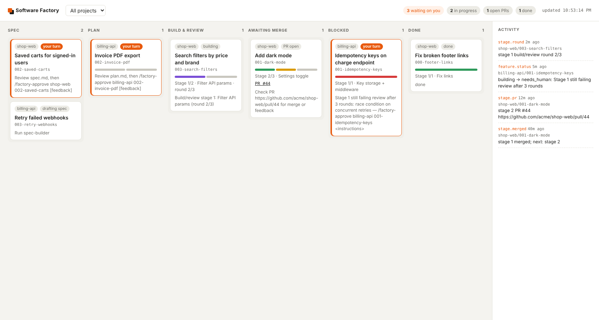

# Software Factory

A spec → plan → build → review → PR pipeline that you point at any git repository, orchestrated by Claude Code.


What my kanban for tracking looks like


## Requirements
- [Claude Code](https://docs.claude.com/en/docs/claude-code)
- Node.js 20+ and git
- For a repo on **GitHub**: the [GitHub CLI](https://cli.github.com/), logged in (`gh auth login`).
- For a repo on **GitLab** (gitlab.com or self-hosted): the [GitLab CLI](https://gitlab.com/gitlab-org/cli), logged in (`glab auth login`). The factory opens merge requests (MRs) there; everything this README says about PRs applies to MRs.

## Quick start
```bash
git clone <this repo> software-factory && cd software-factory
claude                 # accept the workspace trust prompt the first time
```
Then in Claude Code:
```
/factory-init ~/code/my-app          # register a repo; answer a few setup questions
/factory-issue my-app Let signed-in users save their cart and come back to it later
                                      # → drafts projects/my-app/features/001-.../spec.md
                                      # → opens the spec in Claude's plan-review card:
                                      #   Approve → work-planner drafts the plan → the plan card opens
                                      #   Request changes (inline comments OK) → confirm → spec-builder revises → card reopens
                                      # Approving the plan builds stage 1 and opens its PR
/factory-review my-app 001           # reopen the review card for whatever is waiting
/factory-review my-app 001 approve   # or answer by typing:  ... approve | ... <feedback>
# …review & merge the PR on GitHub (or the MR on GitLab)…
/factory-next                        # sees the merge, builds the next stage, handles PR comments
/factory-status                      # what's going on, what's waiting on you
```
In a second terminal, run the dashboard: `npm run dashboard` → http://localhost:4317

During `/factory-init` you can turn on the **PR watcher**: a scheduled task (in the Claude desktop app) that checks the factory's open PRs every 15/30/60 minutes with `gh` or `glab` (`node scripts/factory.mjs watch:check <project>`). When a PR gets a review or comment, or merges, it runs `/factory-next` for you, so the builder addresses the review and the next stage starts. It runs only while the desktop app is open.

You can review specs and plans from the dashboard: open a feature that is waiting on you, read the spec (or plan), then **Approve** or **Request changes**. The dashboard records your decision; run `/factory-next` in Claude Code to start the next step.

## What you give it
- **The repo path.** The factory reads the git remote to get `owner/repo` and whether it's on GitHub or GitLab, detects the base branch, and works out the build, test and lint commands and the conventions from the code and CI. It asks you only what it couldn't work out: review lenses, PR size, approval gates, how PR comments are handled, off-limits paths.
- **Issues**, typed in by hand for now (`/factory-issue`). The source is stored in `config.json` as `issues.source: "manual"`, so a GitHub Issues, Linear or Jira reader can be added later without changing the flow.

## How it works
| Piece | Where |
|---|---|
| Orchestrator rules | `CLAUDE.md` |
| Slash commands | `.claude/skills/factory-{init,issue,review,next,status}/SKILL.md` |
| Subagents | `.claude/agents/{spec-builder,work-planner,builder,reviewer}.md` |
| State CLI (all transitions, worktrees, PRs) | `scripts/factory.mjs` (run with no args for help) |
| Dashboard | `dashboard/` (zero-dependency Node server + one HTML page) |
| Permissions | `.claude/settings.json` (edits auto-accepted inside the factory folder; force-push, `gh pr merge` and `glab mr merge` denied) |

### State: one folder per project (gitignored)
```
projects/<project>/
  config.json        detected repo info + your setup answers
  events.jsonl       activity log
  checkout/          read-only worktree of <remote>/<base> that agents read
  worktrees/         one git worktree per stage in progress
  features/<NNN-slug>/
    issue.md  spec.md  plan.md  stages.json  state.json
    stages/<n>/build-<k>.md  review-<k>.md  pr-feedback-<k>.md  pr-body-src.md
```
Your own clone of the target repo is never modified. The factory adds git worktrees to it, and those live under `projects/`.

### Rules the factory enforces
- Build ⇄ review is capped at **3 rounds** per stage (`review.maxRounds`). After that, the stage is marked **needs you**. Unblock it with `/factory-review <project> <feature> <guidance>`.
- **The next stage starts only after the previous PR is merged.** It branches from the updated base. (Opt in to stacked PRs instead, below.)
- The factory never merges, force-pushes or rebases shared branches. In stacked mode it rebases and force-pushes (with lease) only its own stage branches. Its own PR comments carry a hidden marker so they're never mistaken for your feedback.

### PR review comments
Set during `/factory-init` (`prFeedback.mode`):
- `builder-reads-pr` (default): `/factory-next` picks up new PR comments and inline reviews. The builder fixes them, the reviewer re-checks, the fix is pushed, and a summary is posted as a reply.
- `plugin`: you handle PR comments yourself with your Claude plugin. The factory just notes them.
- `webhook`: reserved. It currently behaves like `builder-reads-pr`.

## Running it unattended
`/factory-next` is safe to run repeatedly: it does the next step for each feature and stops at your gates. To poll for merges and comments, schedule it, for example:
```bash
*/15 * * * * cd ~/software-factory && claude -p "/factory-next" >> ~/.factory.log 2>&1
```
Headless runs can't answer permission prompts. During `/factory-init`, say yes to pre-approving the project's commands, which writes them to `.claude/settings.local.json`, or extend the allow list yourself.

## Development
```bash
npm test                 # CLI end-to-end (local bare remote + fake gh / glab) and dashboard API tests
npm run status
```

### Stacked PRs (optional)
By default stages are strictly sequential. To build and review stage N+1 while stage N's PR is still open, set (per project):
```
node scripts/factory.mjs config:set <project> planning.nextStageTrigger stack
node scripts/factory.mjs config:set <project> planning.maxStackDepth 2
```
- Stage N+1 branches from stage N's branch and its PR targets that branch ("Stacked on PR #N").
- At most `maxStackDepth` PRs are open at once; the next stage waits for a merge.
- When stage N changes (review fixes) the factory rebases the later stages onto it. When stage N merges, later stages are rebased onto the updated base and their PRs retarget it. Review and merge in order, bottom of the stack first.
- A rebase conflict stops the stack: the stage is flagged and the feature is **needs you**. Resolve it in the stage's worktree, then run `node scripts/factory.mjs stage:restack <project> <feature>`.
